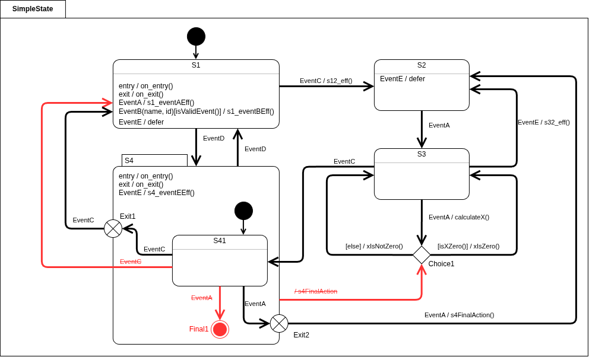

# statechart-to-msm

[](LICENSE)

Claude Code plugin that generates production-ready Boost.MSM C++ code, unit tests and a CMake project from a statechart diagram.

> **Coming to Anthropic's directory:** this plugin will be submitted to
> [Anthropic's plugin directory](https://claude.ai/directory) in the near future. Until it is
> listed there, install it from this repository's own marketplace, as described in
> [Quick Start](#quick-start).

## Content

- [Quick Start](#quick-start)
  - [Keeping statechart-to-msm up to date](#keeping-statechart-to-msm-up-to-date)
  - [Loading a local clone](#loading-a-local-clone)
- [Prerequisites](#prerequisites)
- [Plugins Integrations](#plugins-integrations)
  - [clangd-lsp](#clangd-lsp)
  - [SocratiCode](#socraticode)
- [Example Workflow](#example-workflow)
- [License](#license)

## Quick Start

1. Install the [prerequisites](#prerequisites).
2. Install the plugin. In a Claude Code session (v2.1.275 or later), add the marketplace and
   install in one step, using either the GitHub shorthand or the full repository URL:

   ```text
   /plugin install statechart-to-msm --marketplace leanfrancucci/statechart-to-msm
   /plugin install statechart-to-msm --marketplace https://github.com/leanfrancucci/statechart-to-msm.git
   ```

   Append `#v1.0.0` to either source to pin a release. On earlier versions, or from your shell,
   add the marketplace first and then install:

   ```sh
   claude plugin marketplace add leanfrancucci/statechart-to-msm
   claude plugin install --scope user statechart-to-msm@statechart-to-msm
   claude plugin list
   ```

3. Start a new Claude Code session in the directory that holds your state diagram image, and ask
   for the code, e.g. `Implement the state machine in Blinky.png with Boost.MSM`. The
   `generator` skill loads on its own; to invoke it explicitly, use
   `/statechart-to-msm:generator`.

The skill shows the topology table it read from the diagram, saves it to
`<StateMachineName>/<StateMachineName>.md`, and then scaffolds, implements, builds and tests a
CMake project in `<StateMachineName>/`.

### Keeping statechart-to-msm up to date

```sh
claude plugin marketplace update statechart-to-msm
claude plugin update --scope user statechart-to-msm@statechart-to-msm
```

Or enable auto-update for the marketplace from `/plugin` in a Claude Code session.

### Loading a local clone

To try changes to the skill without installing it, load a clone for one session:

```sh
git clone https://github.com/leanfrancucci/statechart-to-msm.git
cd my-project
claude --plugin-dir /path/to/statechart-to-msm
```

## Prerequisites

| Tool | Version | Used for |
| :--- | :--- | :--- |
| [Claude Code](https://claude.com/claude-code) | — | Running the plugin |
| Python | 3 (standard library only) | The scaffolding script |
| CMake | 3.16 or later | Building the generated project |
| GCC or Clang | C++14 | Compiling the generated code (`-Wall -Wextra -Werror`) |
| Boost | 1.70 or later, with its CMake config files | Boost.MSM (header-only) |
| GoogleTest | optional | Unit tests; downloaded at configure time (v1.14.0) if not installed |
| clang-format | — | Formatting the generated code |

On Ubuntu/Debian:

```sh
sudo apt install build-essential cmake python3 libboost-dev clang-format libgtest-dev
```

Without `libgtest-dev`, the first CMake configure step needs network access to fetch
GoogleTest.

## Plugins Integrations

These plugins are optional. The skill works without them, but uses them when they are present.

### clangd-lsp

For code intelligence on the generated C++ code (go to definition, find references,
diagnostics), install the official `clangd-lsp` plugin, which runs clangd as the language server
for `.c`, `.h`, `.cpp` and `.hpp` files:

```
/plugin install clangd-lsp@claude-plugins-official
```

The plugin only launches clangd, so install the [`clangd`](https://clangd.llvm.org/installation)
binary too, on the host or in the builder container where the code is edited (e.g.
`sudo apt install clangd` on Ubuntu/Debian).

clangd needs the compilation database of each generated project. The scaffolded
`CMakeLists.txt` already exports it (`CMAKE_EXPORT_COMPILE_COMMANDS`), and clangd finds
`<StateMachineName>/build/compile_commands.json` on its own. For other build directories, see
"Generate compile DB for clangd" in `skills/generator/SKILL.md`.

### SocratiCode

When the generated state machine has to fit into an existing project, the skill uses
[SocratiCode](https://github.com/giancarloerra/SocratiCode), if available, to explore that
project semantically: existing events, active objects, loggers, and how they are used. Install
it as a Claude Code plugin:

```sh
claude plugin marketplace add giancarloerra/socraticode
claude plugin install --scope user socraticode@socraticode
```

SocratiCode needs Docker (for its vector database and, by default, its embedding model) and
Node.js 18.17 or later with `npx` on `PATH`; see its
[prerequisites](https://github.com/giancarloerra/SocratiCode#prerequisites). Index your project
before starting (`codebase_index`), so the skill does not fall back to plain text search.

SocratiCode covers your project only. For the Boost.MSM API itself, the skill reads the
installed Boost headers and the official documentation that matches their version (see
`skills/generator/reference.md`).

## Example Workflow

This walk-through uses `SimpleState.png`, one of the reference diagrams shipped with the skill.

<p align="center">
  
</p>

1. **Start a session** in an empty directory that holds the diagram:

   ```sh
   mkdir simple-state && cd simple-state
   curl -LO https://raw.githubusercontent.com/leanfrancucci/statechart-to-msm/main/skills/generator/examples/SimpleState.png
   claude
   ```

2. **Ask for the code:**

   ```
   Implement the state machine in SimpleState.png with Boost.MSM
   ```

3. **Review the topology table.** The skill first translates the diagram into a table with one
   row per state and transition (type, parent state, entry/exit actions, trigger, guard, effect,
   next state). It shows the table and saves it to `SimpleState/SimpleState.md`. Check it
   against the diagram and correct any misread element before going on: the code is built from
   this table, not from the image.

4. **Scaffolding.** The skill runs `scripts/scaffold_statemachine.py`, which creates a project
   that already builds and passes its placeholder tests:

   ```
   SimpleState/
   ├── SimpleState.md        topology table from step 3
   ├── CMakeLists.txt
   ├── src/                  state machine, active object, events, queue, logger, main.cpp
   └── tests/                GoogleTest unit tests
   ```

5. **Implementation.** Guided by the reference examples that match the diagram's features
   (hierarchy, choice pseudo-states, deferred events, ...), the skill writes the states,
   actions, guards and transition table in `src/SimpleState.hpp`, and at least one unit test per
   table row.

6. **Build, test and run.** The skill formats the code, builds it with warnings as errors, and
   runs the tests. You can repeat these steps yourself:

   ```sh
   cmake -S SimpleState -B SimpleState/build
   cmake --build SimpleState/build -j8
   ctest --test-dir SimpleState/build --output-on-failure
   ./SimpleState/build/SimpleState
   ```

   The interactive application maps one key per event (`h` lists them, `q` quits), so you can
   stimulate the state machine and watch the entry, exit and transition traces in real time.

## License

[MIT](LICENSE)
